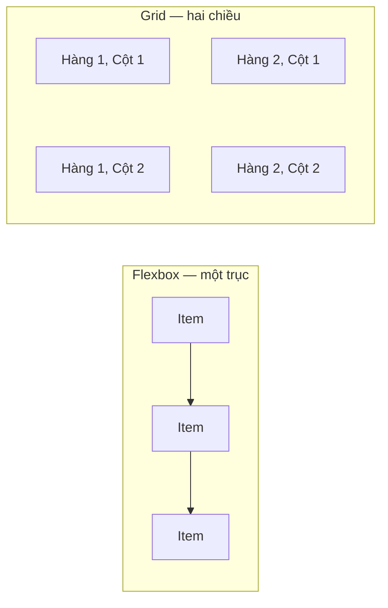

# CSS Grid: khi nào thắng Flexbox, và cách nghĩ theo hàng-cột

Câu phỏng vấn kinh điển: "Flexbox và Grid khác nhau thế nào, chọn cái nào?" Câu trả lời sai phổ biến nhất là "Grid mới hơn nên tốt hơn" — sai, vì chúng giải hai bài toán khác nhau. Flexbox là layout **một chiều**: bạn xếp item theo một trục, và trục kia "tự lo". Grid là layout **hai chiều thật sự**: bạn định nghĩa cả hàng lẫn cột cùng lúc, và một item có thể được đặt chính xác vào một ô hoặc chiếm nhiều ô. Bài này xây dựng đúng mô hình tư duy đó trước khi đi vào cú pháp.

**Tóm tắt:**

- Flexbox phân bổ khoảng trống theo **một trục**; Grid định nghĩa một lưới hai chiều (hàng **và** cột) ngay từ đầu — dùng Grid khi bố cục phụ thuộc vào cả hàng lẫn cột cùng lúc (trang layout, dashboard, form nhiều cột), dùng Flexbox khi chỉ cần xếp một dãy item theo một hướng (navbar, danh sách tag, nhóm nút).
- Đơn vị `fr` (fraction) chia khoảng trống còn lại theo tỉ lệ, tương tự `flex-grow` nhưng áp dụng cho cả `grid-template-columns` lẫn `-rows` cùng lúc.
- Grid có thể **tường minh** (explicit — bạn khai báo đủ số hàng/cột) hoặc **ngầm định** (implicit — item tràn ra ngoài khai báo, trình duyệt tự sinh thêm hàng/cột theo `grid-auto-rows`/`grid-auto-columns`).
- `repeat(auto-fit, minmax(200px, 1fr))` tạo lưới responsive **không cần một media query nào**: số cột tự tăng giảm theo bề rộng khả dụng, mỗi cột tối thiểu 200px.
- `auto-fit` và `auto-fill` chỉ khác nhau khi số item ít hơn số cột có thể chứa: `auto-fit` co các cột rỗng về 0 (item giãn lấp đầy), `auto-fill` giữ nguyên cột rỗng (item giữ kích thước nhỏ, để trống chỗ).
- `grid-template-areas` đặt tên trực quan cho vùng bố cục (header/sidebar/main/footer), giúp CSS đọc giống một sơ đồ layout thật thay vì dãy số tọa độ.
- `subgrid` cho phép lưới con **kế thừa** đường kẻ (track) của lưới cha, giải quyết vấn đề các cột/hàng con không thẳng hàng với lưới cha khi có nhiều cấp lồng nhau.

## Mô hình tư duy: một chiều so với hai chiều



**Nền tảng:** Flexbox không biết trước "cột 2 của hàng 1" là gì — nó chỉ biết thứ tự item trên một trục và tự xuống dòng khi hết chỗ (`flex-wrap`), nhưng các dòng đó **không thẳng hàng cột** với nhau một cách có chủ đích. Grid thì ngược lại: bạn khai báo lưới trước (bao nhiêu cột, rộng bao nhiêu), rồi đặt item vào đúng ô — các cột luôn thẳng hàng xuyên suốt mọi hàng, vì đó là bản chất của một lưới.

| Tiêu chí | Flexbox | Grid |
|---|---|---|
| Số chiều | Một (trục chính), trục phụ "tự lo" | Hai (hàng và cột cùng lúc) |
| Phù hợp cho | Navbar, danh sách tag, nhóm nút, toolbar | Trang layout, dashboard, form nhiều cột, thư viện ảnh |
| Căn item theo nội dung | Mạnh hơn (`flex-grow` theo nội dung từng item) | Cứng hơn, vì ô đã định sẵn kích thước |
| Item tự xuống dòng có thẳng cột không | Không (mỗi dòng độc lập) | Có (cột xuyên suốt mọi hàng) |

**Phải thuộc:** câu trả lời chuẩn cho "Flexbox hay Grid" không phải "cái nào mới hơn" mà là "bố cục của bạn có phụ thuộc đồng thời vào cả hàng và cột không". Rất nhiều layout thực tế dùng **cả hai**: Grid cho khung trang tổng thể (header/sidebar/main/footer), Flexbox cho từng cụm nhỏ bên trong (nhóm nút trong header, danh sách tag trong sidebar).

## Khai báo lưới: `fr`, `repeat`, implicit vs explicit

```css
.layout {
  display: grid;
  grid-template-columns: 200px 1fr 1fr; /* cột 1 cố định 200px, cột 2-3 chia đều phần còn lại */
  grid-template-rows: 60px 1fr 40px;    /* header 60px, nội dung co giãn, footer 40px */
  gap: 16px;
}
```

`fr` (fraction) chia khoảng trống **sau khi** đã trừ đi các cột có kích thước cố định (`200px`) và `gap`. Ở ví dụ trên, cột 2 và cột 3 chia đều phần còn lại theo tỉ lệ 1:1 — giống hệt cách `flex-grow: 1` chia khoảng trống trong Flexbox, chỉ khác là Grid áp dụng đồng thời cho cả trục ngang (cột) và trục dọc (hàng).

### Explicit vs implicit grid

```css
.gallery {
  display: grid;
  grid-template-columns: repeat(3, 1fr); /* explicit: đúng 3 cột */
  grid-auto-rows: 150px;                 /* implicit: hàng tự sinh thêm cao 150px */
}
```

Nếu bạn có 10 item nhưng chỉ khai báo 3 cột (`grid-template-columns`), item thứ 4 trở đi sẽ tự động tràn xuống **hàng mới** — những hàng này là **implicit** (ngầm định, không được khai báo trực tiếp) và có kích thước theo `grid-auto-rows` (mặc định `auto`, tức theo nội dung). Đây là lý do một gallery ảnh chỉ cần khai báo số cột, không cần tính trước có bao nhiêu hàng.

**Phải thuộc:** `grid-template-*` định nghĩa phần **explicit** (bạn kiểm soát hoàn toàn); `grid-auto-*` định nghĩa cách trình duyệt tự sinh thêm track khi item tràn ra ngoài phần explicit đó (**implicit**). Debug một ô Grid "có kích thước lạ không như khai báo" gần như luôn là do nó rơi vào vùng implicit mà bạn quên set `grid-auto-rows`/`grid-auto-columns`.

## `auto-fit` và `auto-fill`: responsive không cần media query

```css
.cards {
  display: grid;
  grid-template-columns: repeat(auto-fit, minmax(200px, 1fr));
  gap: 16px;
}
```

Đọc từ trong ra ngoài: `minmax(200px, 1fr)` nghĩa là mỗi cột tối thiểu 200px, tối đa chia đều phần dư (`1fr`). `repeat(auto-fit, ...)` nghĩa là "lặp lại pattern này **nhiều lần nhất có thể** mà vẫn đủ chỗ 200px cho mỗi cột" — kết quả: container rộng sẽ tự có nhiều cột hơn, container hẹp tự ít cột hơn, hoàn toàn không cần viết một `@media` nào.

### `auto-fit` khác `auto-fill` ở đâu

Cả hai giống hệt nhau **khi số item đủ lấp đầy mọi cột có thể có**. Chúng chỉ khác khi số item **ít hơn** số cột khả dụng:

| | `auto-fit` | `auto-fill` |
|---|---|---|
| Cột "thừa" (không có item) | Co về 0, các item hiện có **giãn ra lấp đầy** | Giữ nguyên kích thước tối thiểu, để **trống chỗ** |
| Dùng khi | Muốn item luôn lấp đầy chiều rộng container | Muốn giữ kích thước item cố định dù container rất rộng (ví dụ lưới icon, swatch màu) |

**Suy luận:** vì sao hai từ khóa gần giống nhau (`fit`/`fill`) lại cho kết quả khác hẳn khi thưa item? Vì `auto-fill` ưu tiên **giữ đúng số track đã có thể tạo ra** theo kích thước container (kể cả khi trống), còn `auto-fit` ưu tiên **thu gọn track rỗng về 0** rồi để các track còn item chiếm hết phần đó thông qua cơ chế `fr`. Nói cách khác, `auto-fill` trả lời câu hỏi "có bao nhiêu cột vừa"; `auto-fit` trả lời câu hỏi "có bao nhiêu cột đang thật sự dùng, phần còn lại nhường cho chúng". Hệ quả thực hành: nếu bạn có 2 card trong một container đủ chỗ cho 5 cột, `auto-fit` cho 2 card to lấp đầy ngang hàng, còn `auto-fill` cho 2 card nhỏ nằm bên trái, bỏ trống 3 "cột ma" bên phải.

## `grid-template-areas`: đặt tên cho dễ đọc

```css
.page {
  display: grid;
  grid-template-columns: 220px 1fr;
  grid-template-rows: 64px 1fr 48px;
  grid-template-areas:
    "sidebar header"
    "sidebar main"
    "sidebar footer";
}
.sidebar { grid-area: sidebar; }
.header  { grid-area: header; }
.main    { grid-area: main; }
.footer  { grid-area: footer; }
```

Mỗi chuỗi trong `grid-template-areas` là một **hàng**, mỗi từ là tên vùng cho một **ô**; lặp lại tên liền kề (như `sidebar` xuất hiện cả 3 hàng) nghĩa là vùng đó chiếm nhiều ô liên tục. `grid-area` trên từng phần tử con chỉ cần ghi đúng tên, không cần tính số thứ tự hàng/cột — đây là lý do cách viết này dễ đọc hơn hẳn so với `grid-column: 1 / 2; grid-row: 1 / 4` dù cho ra cùng một kết quả.

**Phải thuộc:** mọi tên trong `grid-template-areas` phải tạo thành **hình chữ nhật liên tục** (không được để một tên xuất hiện ở hai cụm tách rời nhau) — nếu vi phạm, trình duyệt bỏ qua toàn bộ khai báo và coi như không hợp lệ.

## Grid vs Subgrid

```css
.card-grid { display: grid; grid-template-columns: repeat(3, 1fr); gap: 16px; }
.card { display: grid; grid-template-rows: subgrid; grid-row: span 3; }
```

Vấn đề `subgrid` giải quyết: nếu mỗi `.card` tự định nghĩa `grid-template-rows` **riêng**, tiêu đề/nội dung/nút bấm của card A và card B sẽ không thẳng hàng với nhau khi độ dài nội dung khác nhau (ví dụ tiêu đề card A dài 2 dòng, card B 1 dòng). `grid-template-rows: subgrid` khiến lưới con của `.card` **dùng chung đường kẻ hàng** với lưới cha `.card-grid` thay vì tự tính kích thước riêng — kết quả là mọi tiêu đề thẳng hàng, mọi nội dung thẳng hàng, mọi nút bấm thẳng hàng xuyên suốt các card, dù nội dung dài ngắn khác nhau.

## Bẫy thường gặp

| Bẫy | Hệ quả | Cách tránh |
|---|---|---|
| Dùng Grid cho một dãy item một chiều (navbar, tag list) | Code dài dòng hơn Flexbox mà không được lợi gì | Chỉ chọn Grid khi thật sự cần cả hàng lẫn cột |
| Quên `grid-auto-rows` khi item có thể tràn hàng | Hàng ngầm định cao theo nội dung, không đều | Set `grid-auto-rows` tường minh nếu cần hàng đều |
| Nhầm `auto-fit` với `auto-fill` khi ít item | Layout co giãn sai ý muốn khi container rất rộng | Nhớ: `fit` co track rỗng về 0, `fill` giữ track rỗng |
| Tên vùng trong `grid-template-areas` không tạo hình chữ nhật | Toàn bộ khai báo bị bỏ qua | Vẽ lại layout trên giấy trước khi gõ tên vùng |
| Mỗi card tự `grid-template-rows` riêng | Nội dung giữa các card không thẳng hàng | Dùng `subgrid` để kế thừa track của lưới cha |

## Câu hỏi tự kiểm tra

1. **Khi nào chọn Grid thay vì Flexbox cho một thanh toolbar chỉ có vài nút xếp ngang?**
   Gợi ý: nhớ tiêu chí một chiều vs hai chiều.
   Đáp án: Không nên — toolbar chỉ cần sắp xếp theo một trục, Flexbox phù hợp và đơn giản hơn; Grid chỉ đáng dùng khi bố cục phụ thuộc cả hàng lẫn cột.

2. **`grid-template-columns: repeat(auto-fit, minmax(150px, 1fr))` với 2 item trong container đủ chỗ cho 4 cột. Hai item trông thế nào?**
   Gợi ý: nhớ hành vi riêng của `auto-fit` khi thưa item.
   Đáp án: Hai item giãn to ra, chia đều hết chiều rộng container (cột rỗng co về 0 nên phần `fr` dồn hết cho 2 cột còn item).

3. **Vì sao nội dung bên trong các card có chiều cao khác nhau lại không thẳng hàng dù đã dùng chung một Grid cha?**
   Gợi ý: mỗi card có tự định nghĩa lưới riêng không?
   Đáp án: Vì mỗi `.card` có `display: grid` và `grid-template-rows` **riêng**, không liên quan đến track của lưới cha; cần `grid-template-rows: subgrid` để các card dùng chung đường kẻ hàng với cha.

## Điều cần nhớ

- Flexbox cho layout một chiều, Grid cho layout hai chiều thật sự; nhiều trang dùng cả hai ở hai tầng khác nhau.
- `repeat(auto-fit, minmax(min, 1fr))` là cách làm responsive-không-media-query chuẩn; nhớ phân biệt `auto-fit` (co track rỗng) với `auto-fill` (giữ track rỗng).
- `grid-template-areas` đáng dùng cho layout trang tổng thể vì dễ đọc; `subgrid` giải quyết đúng vấn đề "các lưới con không thẳng hàng với nhau" khi lồng nhiều cấp.
