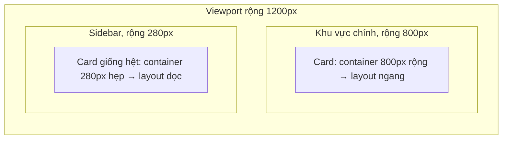
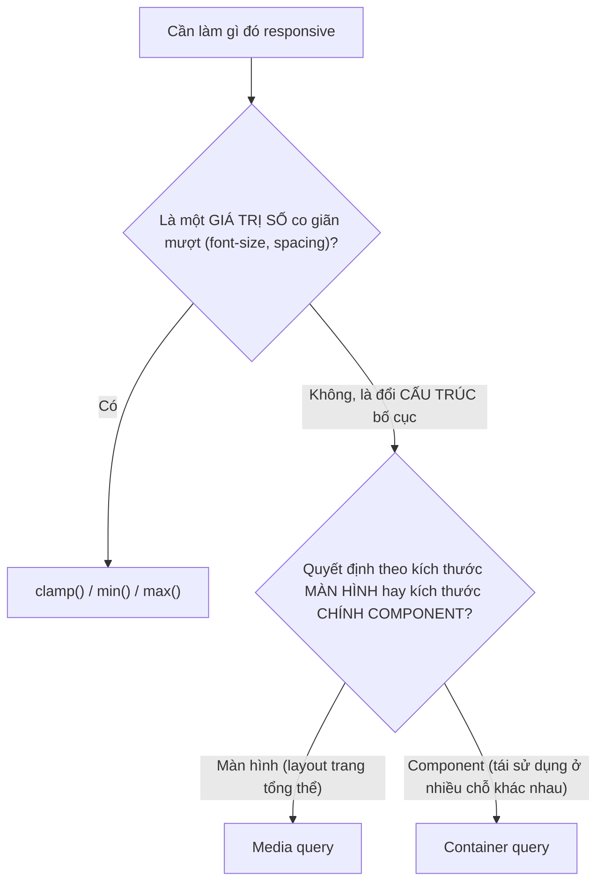

# Responsive design: media query, container query và co giãn không cần breakpoint

"Responsive" từng chỉ có nghĩa một thứ: viết `@media (max-width: ...)` cho vài breakpoint cố định (điện thoại, tablet, desktop) rồi hy vọng mọi kích thước màn hình ở giữa cũng ổn. Cách đó vẫn đúng và vẫn cần, nhưng CSS hiện đại có thêm hai công cụ giải quyết đúng những chỗ media query không làm được: **container query** (responsive theo kích thước của chính component, không phải màn hình) và các hàm `clamp()`/`min()`/`max()` (co giãn liên tục, không cần breakpoint nào). Bài này đặt cả ba cạnh nhau để bạn biết dùng cái nào cho đúng việc.

**Tóm tắt:**

- Mobile-first (viết CSS mặc định cho màn hình nhỏ, rồi `min-width` mở rộng dần lên) thường cho CSS gọn hơn desktop-first, vì màn hình nhỏ thường là phiên bản "lược bớt" chứ không phải "thêm vào".
- Media query không chỉ lọc theo `width` — `prefers-color-scheme` phát hiện chế độ tối hệ điều hành, `prefers-reduced-motion` phát hiện người dùng đã tắt hiệu ứng chuyển động (bắt buộc tôn trọng vì lý do tiếp cận, xem bài Animation ở Frontend-Core).
- Media query đọc kích thước **viewport** (toàn màn hình trình duyệt) — nên một component y hệt nhau sẽ nhận cùng một breakpoint dù nó nằm full-width hay bị nhét trong sidebar hẹp, kể cả khi điều đó không hợp lý.
- Container query (`@container`) đọc kích thước của **chính phần tử cha được đánh dấu làm container**, không phải viewport — cho phép một component tự đổi layout theo không gian nó thực sự có, bất kể nó nằm ở đâu trên trang.
- Muốn dùng container query, phải khai báo `container-type` trên phần tử cha trước — container query không tự động hoạt động như media query.
- `clamp(min, preferred, max)` cho một giá trị co giãn liên tục giữa hai cận, dựa theo một đơn vị tương đối (thường `vw`) — thay thế được rất nhiều cặp `@media` chỉ để đổi `font-size` theo vài mốc.
- Container query và `clamp()` không thay thế hoàn toàn media query: đổi **bố cục toàn trang** (ẩn sidebar, đổi số cột của cả lưới trang) vẫn hợp lý nhất với media query, vì đó thật sự là quyết định theo kích thước màn hình.

## Mobile-first so với desktop-first

```css
/* Mobile-first: mặc định cho màn hình nhỏ, mở rộng dần */
.card { flex-direction: column; }
@media (min-width: 768px) {
  .card { flex-direction: row; }
}
```

```css
/* Desktop-first: mặc định cho màn hình lớn, thu hẹp dần */
.card { flex-direction: row; }
@media (max-width: 767px) {
  .card { flex-direction: column; }
}
```

Hai cách đều hợp lệ và cho cùng kết quả ở ví dụ đơn giản này. Sự khác biệt lộ ra khi trang có **nhiều** quyết định responsive chồng lên nhau: mobile-first có xu hướng CSS ngắn hơn vì bạn chỉ "thêm" độ phức tạp (cột, sidebar, hover effect) khi có đủ chỗ, còn phiên bản mobile thường là tập con đơn giản hóa. Desktop-first dễ viết hơn về mặt tư duy (thiết kế thường bắt đầu từ bản desktop) nhưng dễ phải "undo" nhiều thuộc tính khi thu nhỏ, dẫn đến CSS dài và rối hơn theo thời gian.

**Phải thuộc:** mobile-first dùng `min-width` (mở rộng khi màn hình **đủ lớn**); desktop-first dùng `max-width` (thu hẹp khi màn hình **đủ nhỏ**). Nhầm lẫn hai hướng này là lỗi viết media query phổ biến nhất ở người mới.

## Media query không chỉ về `width`

| Feature | Phát hiện gì | Dùng khi |
|---|---|---|
| `width` / `height` | Kích thước viewport | Đổi bố cục theo kích thước màn hình |
| `prefers-color-scheme: dark` | Hệ điều hành đang ở chế độ tối | Cung cấp theme tối mặc định khớp hệ thống |
| `prefers-reduced-motion: reduce` | Người dùng đã tắt hiệu ứng chuyển động trong cài đặt hệ thống (vì lý do sức khỏe/tiếp cận) | **Bắt buộc** tắt hoặc giảm animation không thiết yếu — xem chi tiết kỹ thuật animation ở [Frontend-Core: Animation và motion trên web](../../11-Frontend-Core/lt-07-animation-motion-web.md) |
| `orientation: landscape/portrait` | Hướng màn hình | Layout khác nhau giữa xoay ngang/dọc (ít dùng hơn width) |
| `hover: hover` / `pointer: fine` | Thiết bị có chuột thật (hover chính xác) hay chỉ cảm ứng | Ẩn hiệu ứng hover trên thiết bị cảm ứng, vì hover không tồn tại theo nghĩa đó trên màn hình chạm |

```css
@media (prefers-color-scheme: dark) {
  :root { --bg: #0f172a; --text: #e2e8f0; }
}
@media (prefers-reduced-motion: reduce) {
  * { animation-duration: 0.01ms !important; transition-duration: 0.01ms !important; }
}
```

**Nền tảng:** `prefers-reduced-motion` không phải một tùy chọn "nice to have" — với một số người dùng, chuyển động lớn/nhanh trên màn hình gây chóng mặt hoặc buồn nôn thật sự (rối loạn tiền đình). Tôn trọng media query này là yêu cầu tiếp cận cơ bản, không phải tối ưu thẩm mỹ.

## Container query: responsive theo component, không theo màn hình

Vấn đề media query không giải được: một component `.product-card` hiển thị layout ngang khi đủ rộng, dọc khi chật — điều này đúng dù nó nằm full-width trên trang chi tiết, hay bị nhét vào một sidebar hẹp 300px trên trang danh sách. Media query chỉ biết **viewport** rộng bao nhiêu, không biết `.product-card` thực tế có bao nhiêu chỗ — nên component y hệt nhau buộc phải đổi layout cùng một lúc trên toàn trang, dù chỗ chứa nó khác nhau.

```css
.card-container {
  container-type: inline-size; /* bắt buộc: khai báo phần tử này LÀ một container để đo */
  container-name: card;         /* tùy chọn: đặt tên để @container chọn đúng container khi lồng nhiều cấp */
}

@container card (min-width: 400px) {
  .product-card { display: flex; flex-direction: row; }
}
@container card (max-width: 399px) {
  .product-card { display: flex; flex-direction: column; }
}
```

**Phải thuộc:** container query **không tự động hoạt động** — bạn phải khai báo `container-type` (thường `inline-size`, nghĩa là chỉ đo theo chiều ngang) trên phần tử cha trước, rồi `@container` mới có gì để đo. Quên bước này là lý do phổ biến nhất khiến `@container` "không chạy" mà không báo lỗi gì.



**Suy luận:** đây chính xác là điều media query không làm được — cả C1 và C2 trong sơ đồ trên đọc **cùng một** `(min-width: 1200px)` nếu dùng media query, vì cả hai đều nằm trong cùng một viewport 1200px; chúng sẽ buộc phải cùng một layout dù không gian thực tế rất khác nhau. Container query đo đúng không gian cục bộ của từng card, nên C1 và C2 có thể tự quyết định layout độc lập — đây là lý do container query được xem là bước tiến quan trọng nhất cho component thật sự "tái sử dụng được ở mọi nơi" mà không cần biết trước ngữ cảnh nó sẽ bị đặt vào.

## `clamp()`, `min()`, `max()`: co giãn liên tục, không cần breakpoint

```css
h1 { font-size: clamp(1.5rem, 4vw + 1rem, 3rem); }
```

Đọc `clamp(min, preferred, max)`: giá trị thực tế luôn là `preferred` (ở đây `4vw + 1rem`, co giãn theo bề rộng viewport), **trừ khi** nó nhỏ hơn `min` (khi đó dùng `min`) hoặc lớn hơn `max` (khi đó dùng `max`). Kết quả: font chữ co giãn **mượt liên tục** theo mọi kích thước màn hình ở giữa, không nhảy bậc như khi dùng vài `@media` cho vài mốc cố định, và không bao giờ nhỏ hơn 1.5rem hay lớn hơn 3rem dù màn hình cực nhỏ hoặc cực lớn.

| Hàm | Lấy giá trị nào |
|---|---|
| `min(a, b)` | Giá trị **nhỏ hơn** trong hai giá trị — dùng để đặt một "trần" không cố định |
| `max(a, b)` | Giá trị **lớn hơn** trong hai giá trị — dùng để đặt một "sàn" không cố định |
| `clamp(min, preferred, max)` | `preferred`, kẹp trong khoảng `[min, max]` — tương đương `max(min, min(preferred, max))` |

```css
.container { width: min(90%, 1200px); } /* rộng 90% màn hình, nhưng không bao giờ quá 1200px */
.gap { padding: max(16px, 2vw); }        /* ít nhất 16px, nhưng nở theo màn hình lớn */
```

**Phải thuộc:** `clamp()`/`min()`/`max()` không thay thế media query hoàn toàn — chúng giỏi nhất ở việc co giãn một **giá trị số** (font-size, padding, width) liên tục. Khi cần đổi hẳn **cấu trúc bố cục** (ẩn hẳn sidebar, đổi số cột của lưới trang tổng thể, đổi từ menu ngang sang menu hamburger), media query (hoặc container query cho component riêng lẻ) vẫn là công cụ đúng, vì đó là một quyết định rời rạc (có/không, A hoặc B), không phải một giá trị co giãn mượt.

## Chọn công cụ nào cho đúng việc



## Bẫy thường gặp

| Bẫy | Hệ quả | Cách tránh |
|---|---|---|
| Lẫn `min-width` với `max-width` giữa mobile-first/desktop-first | Logic breakpoint chạy ngược | Chọn một hướng cho cả dự án, nhớ đúng chiều |
| Dùng `@container` mà quên `container-type` trên cha | Query không chạy, không báo lỗi | Luôn khai báo container trước khi viết `@container` |
| Dùng media query cho responsive của một component tái dùng nhiều nơi | Component đổi layout sai khi bị nhét vào chỗ hẹp dù màn hình rộng | Đổi sang container query cho đúng ngữ cảnh cục bộ |
| Không có cận trong `clamp()` | Chữ quá nhỏ trên màn hình bé hoặc quá to trên màn hình lớn | Luôn đặt `min` và `max` hợp lý, không chỉ dùng `vw` một mình |
| Bỏ qua `prefers-reduced-motion` | Gây khó chịu/hại cho người dùng nhạy cảm chuyển động | Luôn có nhánh giảm animation khi media feature này bật |

## Câu hỏi tự kiểm tra

1. **Một component `.sidebar-widget` cần hiển thị gọn khi nằm trong sidebar hẹp, dù trang đang ở màn hình desktop rộng. Dùng media query hay container query?**
   Gợi ý: quyết định theo không gian của chính nó hay của màn hình?
   Đáp án: Container query — vì quyết định phụ thuộc vào không gian thực tế của widget, không phải kích thước viewport.

2. **`font-size: clamp(1rem, 2vw, 2rem)` trên màn hình rất hẹp khiến `2vw` tính ra chỉ 0.6rem. Font thực tế là bao nhiêu?**
   Gợi ý: nhớ vai trò của cận dưới.
   Đáp án: 1rem — vì `preferred` (0.6rem) nhỏ hơn `min` (1rem), `clamp()` kẹp về cận dưới.

3. **Viết `@container (min-width: 400px) {...}` nhưng không thấy có tác dụng gì. Nguyên nhân phổ biến nhất là gì?**
   Gợi ý: container query cần một bước khai báo trước.
   Đáp án: Quên đặt `container-type` (ví dụ `inline-size`) trên phần tử cha — không có khai báo đó, trình duyệt không coi phần tử nào là container để đo.

## Điều cần nhớ

- Mobile-first dùng `min-width` mở rộng dần; desktop-first dùng `max-width` thu hẹp dần — chọn một hướng và giữ nhất quán.
- Container query giải đúng vấn đề media query không làm được: responsive theo không gian thật của component, không phải theo viewport — nhưng cần `container-type` trên cha trước khi dùng được `@container`.
- `clamp()`/`min()`/`max()` co giãn giá trị số liên tục mà không cần breakpoint; dùng cho font-size/spacing, còn đổi cấu trúc bố cục vẫn nên dùng media/container query.
