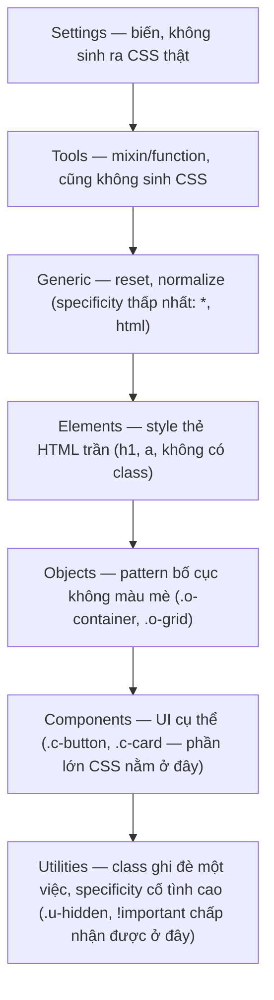

# CSS Variables, BEM và kiến trúc CSS khi dự án lớn dần

Một file CSS 50 dòng không cần kiến trúc gì cả — đặt tên class sao cũng chạy. Vấn đề xuất hiện khi file đó lớn lên thành 50 file: đổi màu một nút bấm làm vỡ giao diện ở ba trang khác vì tình cờ trùng class name; thêm `!important` để "thắng" một rule không rõ ở đâu ra; không ai dám xóa CSS cũ vì không biết còn chỗ nào dùng. Bài này đi qua hai công cụ giải quyết đúng vấn đề quy mô đó: **CSS custom property** (biến CSS thật sự, khác hẳn biến Sass) và các **phương pháp đặt tên/tổ chức** (BEM, ITCSS) ra đời để CSS lớn vẫn đoán được, không phải đoán mò.

**Tóm tắt:**

- CSS custom property (`--ten-bien`) là biến **chạy lúc runtime trong trình duyệt**: đổi giá trị bằng JavaScript hoặc media query thì mọi chỗ dùng `var(--ten-bien)` cập nhật ngay, không cần build lại gì cả.
- Biến Sass (`$ten-bien`) chỉ tồn tại **lúc biên dịch** — sau khi build xong, nó đã bị thay thế thành giá trị cứng trong CSS cuối cùng, không đổi được nữa khi trang đã chạy.
- Nhờ đặc tính "runtime" đó, custom property là cách làm dark mode/theme đúng chuẩn hiện đại: đổi một vài biến ở `:root` (hoặc theo `data-theme`), toàn bộ giao diện đổi theo mà không cần JavaScript re-render lại component nào.
- Custom property tuân theo **cascade và kế thừa** như mọi thuộc tính CSS khác — một biến định nghĩa trong `.card` chỉ "nhìn thấy" được bên trong `.card` và con cháu của nó, không phải toàn trang.
- BEM (Block__Element--Modifier) là quy ước đặt tên class giữ **specificity luôn bằng nhau** (mọi class chỉ gồm 1 class đơn, specificity (0,1,0)) — loại bỏ hẳn nguồn gốc phổ biến nhất của "cuộc chiến specificity".
- ITCSS/7-1 là cách sắp xếp **thứ tự nạp** các nhóm CSS (từ chung nhất đến cụ thể nhất) để specificity tự nhiên tăng dần theo thứ tự đọc — tránh được rất nhiều trường hợp phải dùng `!important`.
- Tailwind (utility-first) ra đời một phần như phản ứng với chính vấn đề specificity: mỗi class chỉ làm đúng một việc (`.mt-4` luôn luôn chỉ là margin-top), gần như không có cascade để mà xung đột — đây là góc độ framework, xem [React: Styling và Headless UI](../../09-React/hard/lt-16-styling-headless-ui-react.md) để so sánh Tailwind với các lựa chọn khác trong hệ sinh thái React.

## Custom property: biến thật sự chạy trong trình duyệt

```css
:root {
  --brand: #2563eb;
  --radius: 8px;
}
.btn {
  background: var(--brand);
  border-radius: var(--radius);
}
```

`var(--brand)` tra giá trị của `--brand` **tại thời điểm trình duyệt render**, không phải lúc viết CSS. Đây là khác biệt cốt lõi với biến tiền xử lý (Sass/Less): Sass biên dịch `$brand` thành giá trị cứng ngay khi build, nên sau khi build xong, không có cách nào đổi `$brand` nữa mà không build lại toàn bộ CSS.

| | CSS custom property (`--x`) | Sass variable (`$x`) |
|---|---|---|
| Tồn tại khi nào | Runtime, trong trình duyệt | Compile-time, biến mất sau khi build |
| Đổi được bằng JS không | Có (`el.style.setProperty('--x', ...)`) | Không (đã thành giá trị cứng) |
| Tuân theo cascade/kế thừa | Có | Không (chỉ là "tìm-thay-thế" văn bản lúc build) |
| Dùng trong media query để đổi giá trị | Có | Không trực tiếp (phải viết lại rule) |

**Phải thuộc:** câu phân biệt gọn nhất cho phỏng vấn — custom property là biến **CSS thật**, tồn tại và đổi được sau khi trang đã tải; biến Sass chỉ là công cụ **sinh văn bản** lúc build, không tồn tại gì cả khi trình duyệt nhận CSS cuối cùng.

### Dark mode không cần JavaScript re-render

```css
:root {
  --bg: #ffffff;
  --text: #0f172a;
}
:root[data-theme="dark"] {
  --bg: #0f172a;
  --text: #e2e8f0;
}
body { background: var(--bg); color: var(--text); }
```

```js
document.documentElement.setAttribute('data-theme', 'dark'); // chỉ đổi 1 attribute
```

**Suy luận:** vì sao cách này không cần re-render component nào trong khi đổi theme bằng cách tính lại style trong JavaScript (ví dụ set `style={{background: isDark ? '#000' : '#fff'}}` ở mọi component) thì cần? Vì mọi nơi dùng `var(--bg)` đã **tự động** tra lại giá trị mới ngay khi `--bg` đổi — trình duyệt tự làm việc "tìm mọi chỗ dùng biến này và cập nhật" như một phần của cơ chế cascade, không phải code của bạn phải lặp qua từng component. Đổi một attribute `data-theme` trên `<html>` là đủ để toàn bộ cascade bên dưới tính lại, đúng với cách CSS vốn được thiết kế để hoạt động.

### Phạm vi của biến: cũng là cascade

```css
.card { --accent: blue; }
.card .title { color: var(--accent); } /* thấy được, vì .title là con của .card */
.other { color: var(--accent); }       /* KHÔNG thấy, vì .other không nằm trong .card */
```

**Nền tảng:** custom property kế thừa xuống con cháu giống thuộc tính chữ (`color`, `font-*`) — định nghĩa trong một phần tử chỉ "nhìn thấy" được bên trong phạm vi DOM của phần tử đó và con cháu nó. Đây là lý do biến theme toàn cục thường đặt ở `:root` (phạm vi toàn trang), còn biến cục bộ (ví dụ `--card-padding` riêng cho một loại card) đặt ngay trên class của component đó.

## BEM: giữ specificity luôn bằng nhau

```css
/* Block */
.card { }
/* Element — thuộc về block, nối bằng __ */
.card__title { }
.card__image { }
/* Modifier — biến thể của block hoặc element, nối bằng -- */
.card--featured { }
.card__title--large { }
```

```html
<div class="card card--featured">
  
  <h3 class="card__title card__title--large">...</h3>
</div>
```

BEM (Block, Element, Modifier) là một **quy ước đặt tên**, không phải tính năng CSS mới. Quy tắc duy nhất thật sự quan trọng: **mọi selector chỉ gồm đúng một class**, không bao giờ lồng selector (`.card .title`) hay dùng ID. Hệ quả: mọi class BEM có specificity giống hệt nhau — `(0, 1, 0)` — nên **không có khái niệm "class này thắng class kia vì đặc hiệu hơn"**; ai thắng chỉ còn phụ thuộc vào thứ tự nạp CSS, điều bạn hoàn toàn kiểm soát được.

**Phải thuộc:** lợi ích thật sự của BEM không phải là "đặt tên có vẻ chuyên nghiệp" — mà là loại bỏ hoàn toàn nguồn gốc phổ biến nhất của specificity war (selector lồng nhau, trộn ID với class) bằng cách ép mọi thứ về cùng một mức đặc hiệu. Khi mọi class cùng specificity, CSS trở nên **dự đoán được theo thứ tự đọc** — đúng như cascade vốn được thiết kế để hoạt động trước khi người ta lạm dụng ID và selector lồng sâu.

## ITCSS/7-1: thứ tự nạp quyết định, không phải chỉ tên gọi

ITCSS (Inverted Triangle CSS) tổ chức file CSS theo thứ tự từ **chung nhất, ít đặc hiệu nhất** đến **cụ thể nhất, đặc hiệu cao nhất**:



**Suy luận:** vì sao thứ tự này lại giảm nhu cầu dùng `!important`? Vì theo quy tắc cascade, khi specificity bằng nhau thì **rule đọc sau thắng** — ITCSS cố tình sắp các rule càng cụ thể càng nạp sau, nên trong phần lớn trường hợp bạn không cần ép specificity cao hơn để thắng: thứ tự nạp đã tự nhiên cho component thắng reset, và utility (nạp sau cùng) thắng component. Pattern 7-1 là một cách chia thư mục cụ thể hóa ý tưởng ITCSS (7 thư mục: base, components, layout, pages, themes, abstracts, vendors + 1 file tổng `main.scss` import theo đúng thứ tự).

## Vì sao utility-first (Tailwind) xuất hiện

Nếu BEM và ITCSS đã giải được specificity war, vì sao Tailwind vẫn ra đời và phổ biến? Vì cả hai vẫn yêu cầu **con người tuân thủ kỷ luật đặt tên và thứ tự nạp** — một class mới viết sai quy ước vẫn phá được hệ thống. Tailwind đi xa hơn: mỗi class chỉ làm **đúng một việc duy nhất và không bao giờ đổi nghĩa** (`.mt-4` luôn luôn chỉ là `margin-top: 1rem`, không có ngữ cảnh nào làm nó có nghĩa khác) — gần như không còn gì để cascade quyết định, vì không có hai rule nào tranh nhau cùng một thuộc tính trên cùng phần tử theo cách khó đoán. Đây là góc nhìn thuần CSS về lý do Tailwind giải quyết specificity war triệt để hơn quy ước đặt tên; phần so sánh Tailwind với CSS Modules, CSS-in-JS và các thư viện headless UI trong hệ sinh thái React cụ thể nằm ở [React: Styling và Headless UI](../../09-React/hard/lt-16-styling-headless-ui-react.md).

## Bẫy thường gặp

| Bẫy | Hệ quả | Cách tránh |
|---|---|---|
| Tưởng custom property là biến Sass | Cố đổi `$x` bằng JS lúc runtime, không hiểu sao không chạy | Nhớ Sass biến mất sau build; chỉ `--x` mới sống trong trình duyệt |
| Đặt biến theme bên trong một component cụ thể | Biến không thấy được ở nơi khác cần dùng chung | Đặt biến toàn cục ở `:root`, biến cục bộ mới đặt trong component |
| Trộn BEM với selector lồng (`.card .card__title`) | Mất tác dụng "specificity luôn bằng nhau" của BEM | Luôn dùng đúng 1 class full-BEM-name, không lồng selector |
| Nạp CSS component trước CSS reset/generic | Component bị reset ghi đè ngược, phải thêm `!important` để sửa | Theo đúng thứ tự ITCSS: chung → cụ thể → utility |
| Viết utility class nhưng để nó ở đầu file (nạp trước component) | Utility bị component ghi đè, mất tác dụng "luôn thắng" | Utility luôn nạp **sau cùng** theo đúng vai trò của nó |

## Câu hỏi tự kiểm tra

1. **Vì sao đổi `--brand-color` ở `:root` bằng JavaScript cập nhật giao diện ngay lập tức, nhưng đổi `$brand-color` trong file Sass thì không?**
   Gợi ý: nhớ custom property sống ở đâu, biến Sass sống ở đâu.
   Đáp án: `--brand-color` là biến CSS thật, trình duyệt tra giá trị mới mỗi khi cần vẽ lại; `$brand-color` đã bị thay bằng giá trị cứng ngay lúc build, trang đã chạy không còn khái niệm "biến Sass" nữa để mà đổi.

2. **Hai class BEM `.card__title` và `.card__title--large` cùng áp lên một phần tử, cả hai đều đặt `font-size`. Cái nào thắng, và dựa vào đâu?**
   Gợi ý: cả hai đều single-class, specificity bằng nhau.
   Đáp án: Specificity bằng nhau `(0,1,0)` cho cả hai, nên rule nào **nạp sau** trong nguồn thắng — không phải vì modifier "đặc biệt hơn".

3. **Theo ITCSS, vì sao utility class được phép dùng `!important` trong khi component thì không nên?**
   Gợi ý: utility nằm ở đâu trong thứ tự nạp và vai trò của nó là gì.
   Đáp án: Utility nạp sau cùng và có vai trò "luôn luôn ghi đè để làm đúng một việc" (ví dụ ẩn phần tử bất kể ngữ cảnh nào gọi nó) — `!important` ở đây là chủ đích, khác với dùng `!important` tùy tiện trong component để chữa cháy specificity.

## Điều cần nhớ

- Custom property (`--x`) là biến CSS thật, sống và đổi được trong trình duyệt lúc runtime; biến Sass (`$x`) chỉ tồn tại lúc build rồi biến mất — đây là lý do custom property mới làm được dark mode không cần JS re-render.
- BEM giữ mọi class ở cùng một mức specificity để loại bỏ specificity war; ITCSS/7-1 sắp thứ tự nạp từ chung đến cụ thể để cascade tự nhiên cho đúng thứ thắng mà không cần `!important`.
- Utility-first (Tailwind) đẩy ý tưởng "giảm xung đột cascade" đi xa hơn bằng cách làm mỗi class chỉ có đúng một nghĩa cố định — phần so sánh với các lựa chọn styling khác trong React nằm ở bài riêng, không lặp lại ở đây.
